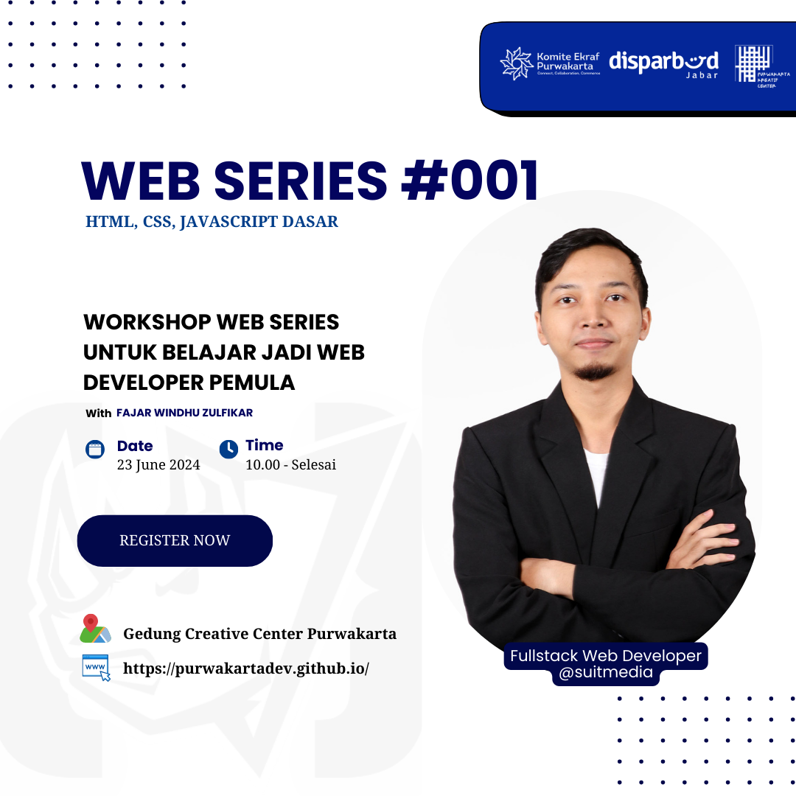
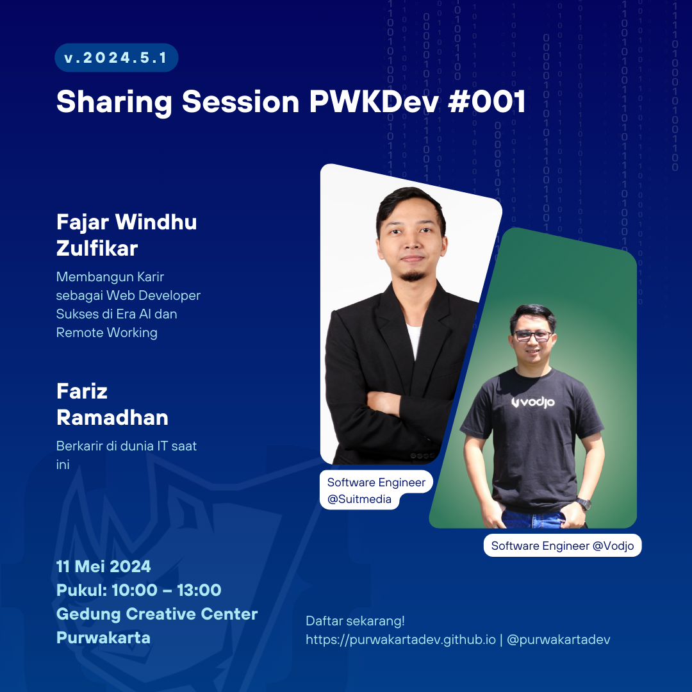
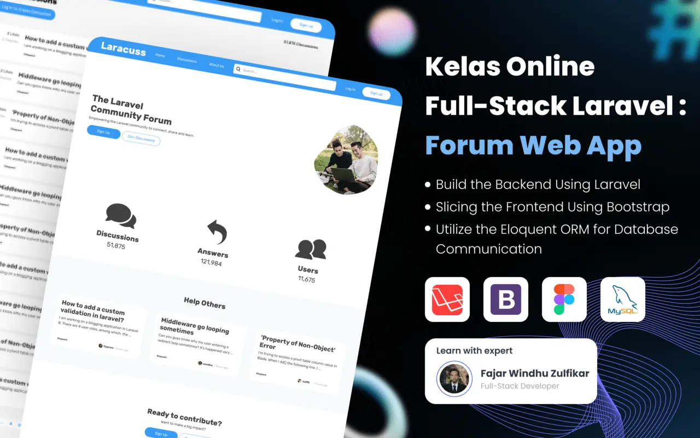

<!--
**fajarwz/fajarwz** is a ✨ _special_ ✨ repository because its `README.md` (this file) appears on your GitHub profile.

Here are some ideas to get you started:

- 🔭 I’m currently working on ...
- 🌱 I’m currently learning ...
- 👯 I’m looking to collaborate on ...
- 🤔 I’m looking for help with ...
- 💬 Ask me about ...
- 📫 How to reach me: ...
- 😄 Pronouns: ...
- ⚡ Fun fact: ...
-->

# 👋 Hi, I'm Fajar Windhu Zulfikar (@fajarwz), A Senior Marketplace Developer | Laravel | React | Full Stack Developer

I'm a Full-Stack Software Engineer specializing in building and scaling marketplace platforms for the European, UK, and US markets. My experience spans cross-border e-commerce, payment processing, taxation, shipping, localization, and marketplace operations, with a strong focus on backend architecture using PHP and Laravel.

## 👋 About Me

I'm a software engineer passionate about building web applications, exploring new technologies, and solving real-world problems.

### 🛠️ Tech Stack

**Frontend**

**Backend**

**Desktop & Mobile**

**Databases & Storage**

**Tools & Testing**

**Other**

### 📫 Connect

## 🖥️ Open Source Contributions
- 🔥 Laravel | The most popular PHP web app framework, 585M+ downloads, 84K+ stars (main repo): [laravel/framework](https://github.com/laravel/framework/pulls?q=is%3Apr+author%3Afajarwz) 
- 🔥 Cachet | platform status page, 1M+ downloads, 15K+ stars (main repo): [cachethq/core](https://github.com/cachethq/core/pulls?q=is%3Apr+author%3Afajarwz) 
- 🔥 Bagisto | eCommerce platform, 150K+ downloads, 28K+ stars: [bagisto/bagisto](https://github.com/bagisto/bagisto/pulls?q=is%3Apr+author%3Afajarwz) 
- 🔥 Akaunting | accounting software, 300K+ users, 10K+ stars: [akaunting/akaunting](https://github.com/akaunting/akaunting/pulls?q=is%3Apr+author%3Afajarwz) 
- Git Mapper | desktop Git history graph viewer, 400+ downloads: [fajarwz/git-mapper](https://github.com/fajarwz/git-mapper)
- Fitsume (one-page resume generator): [fajarwz/fitsume](https://github.com/fajarwz/fitsume)
- Laravel Review (flexible review system for Laravel): [fajarwz/laravel-review](https://github.com/fajarwz/laravel-review)
- Iket (IT ticketing app): [fajarwz/iket](https://github.com/fajarwz/iket)
- Mayhugo (clean, lightweight, minimalist Hugo theme): [fajarwz/mayhugo](https://github.com/fajarwz/mayhugo)
- Goodbook (book review app): [fajarwz/goodbook-fe](https://github.com/fajarwz/goodbook-fe)
- Lenovo Conservation Scheduler (Windows tray utility that switches Lenovo battery conservation mode on a schedule): [fajarwz/lenovo-conservation-scheduler](https://github.com/fajarwz/lenovo-conservation-scheduler)
- Kawal Asap (hotspot and haze monitoring for Indonesia, from free and keyless public data): [fajarwz/kawalasap](https://github.com/fajarwz/kawalasap)
- Telegram bot for learning English in a fun way. You can request random words, take quizzes, or even sign up for daily vocabulary practice sessions: [Wordventure](https://t.me/wordventure_bot)

## 💬 Talks
- "IDCamp Alumni Dialogue #2 - Work ~Hard~ Smart: How to Work Smartly to Increase Productivity! (IDCamp Alumni Dialogue #2 - Work Smart: Cara Kerja Cerdas yang Bikin Produktivitas Melesat!)", was live on Dicoding Indonesia's Youtube. [Read more](https://www.dicoding.com/events/9133). 
- "Web Series #002: Creating a Notes App With Bootstrap & jQuery (Bikin Notes App Pakai Bootstrap & jQuery)", was conducted online. [Read more](https://purwakartadev.github.io/posts/sharing-session-003/). 

View poster

- "Web Series #001: HTML, CSS, and JavaScript Basics (Web Series #001: HTML, CSS, JavaScript Dasar)", at the Gedung Creative Center Purwakarta, Indonesia. [Read more](https://purwakartadev.github.io/posts/sharing-session-002/). 

View poster

- "Building a Career as a Successful Web Developer in the age of AI and Remote Working (Membangun Karir sebagai Web Developer Sukses di Era AI dan Remote Working)" at the Gedung Creative Center Purwakarta, Indonesia. [Read more](https://purwakartadev.github.io/posts/sharing-session-001/).
 

View poster

- The topic is the same as above. A guest lecture with the topic "Building a Career as a Successful Web Developer in the age of AI and Remote Working (Membangun Karir sebagai Web Developer Sukses di Era AI dan Remote Working)", was live on STT Wastukancana Purwakarta's Youtube. [Watch the recording](https://www.youtube.com/live/uwTCt5kF6e0?si=RuJyqqXDxJ6uuSGO).
 
- Internal talk on "Fundamentals of Backend Communications and Protocols" for Suitmedia, was conducted online. [View Instagram Post](https://www.instagram.com/p/C47MwF0PFGR/?igsh=Z3ExZGd5dm4xYjd3). 

View poster

## 💼 Career
I'm currently open to work and ready to join ASAP, [hit me up right away](mailto:fajarwindhuzulfikar@gmail.com)!

## 🔖 Products
- Paid web development tutorial in Indonesia | Belajar jadi Full Stack Laravel Web Developer, buat web forum DARI AWAL SAMPAI HOSTING (Learn to become a Full Stack Laravel Web Developer, BUILD AND HOST A FORUM WEBSITE FROM SCRATCH):
[fajarwz.com/laracuss](https://fajarwz.com/laracuss) 
- Blog, free web development tutorials in English, mostly with example projects. Getting 10K views per month:
[fajarwz.com/blog](https://fajarwz.com/blog)

## 📚 Recent Blog Posts
<!-- BLOG-POST-LIST:START -->
- [Git Mapper: Read Your Repo Like a Feed, Not a Terminal](https://fajarwz.com/blog/git-mapper-standalone-git-history-viewer/)
- [Schedule Lenovo Conservation Mode on Windows](https://fajarwz.com/blog/schedule-lenovo-conservation-mode-on-windows/)
- [Building an AI Agent in Laravel with the Laravel AI SDK](https://fajarwz.com/blog/building-an-ai-agent-in-laravel-with-the-laravel-ai-sdk/)
- [Why I Stopped Putting Everything in Laravel Services](https://fajarwz.com/blog/why-i-stopped-putting-everything-in-laravel-services/)
- [Companies Don&#39;t Hire You to Write Code](https://fajarwz.com/blog/companies-dont-hire-you-to-write-code/)
<!-- BLOG-POST-LIST:END -->

## 📫 Social Media
- LinkedIn: [linkedin.com/in/fajarwz](https://www.linkedin.com/in/fajarwz)
- Website: [fajarwz.com](https://fajarwz.com)
- LeetCode: [leetcode.com/fajarwz](https://leetcode.com/fajarwz/)
- Stackoverflow: [fajar wz](https://stackoverflow.com/users/19457054/fajar-wz)
- I also code on Gitlab: [gitlab.com/fajarwz](https://gitlab.com/fajarwz)

